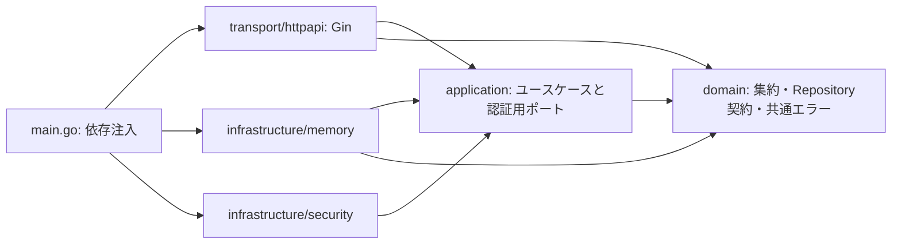

# Go / Gin / Clean Architecture / DDD サンプル

認証付きのタスク管理APIです。テストで振る舞いを定義し、Red → Green → Refactor の順に実装しています。開発過程とテストリストは [docs/tdd.md](docs/tdd.md) に記録しています。

Go と gopls は既存の devbox 環境で管理します。モジュール名は `try_golang`、起動時の依存注入は `main.go` にあります。

## 起動と確認

```sh
devbox install
devbox run -- go mod tidy
devbox run -- go run .
```

別のターミナルから `curl http://127.0.0.1:8080/healthz` を実行すると `{"status":"ok"}` が返ります。Ctrl+C / SIGTERM でリクエストの終了を待って停止します。

```sh
devbox run -- go test ./...
devbox run -- go test -race ./...
devbox run -- go vet ./...
devbox run -- go build ./...
devbox run -- go fmt ./...
```

`devbox run start`、`devbox run test`、`devbox run check` も利用できます。`check` は race 検出付きテスト・vet・build を実行します。CIもdevboxを使用します。Goビルドキャッシュは `.cache/go-build` に分離しています。

設定は環境変数で渡します。`.env.example` は見本で、`.env` の自動読み込みはありません。

| 変数 | 既定値 | 意味 |
| --- | --- | --- |
| `HTTP_ADDR` | `127.0.0.1:8080` | 待受アドレス。例: `:9090` |
| `SESSION_TTL` | `1h` | セッション期限。0より大きく24時間以下 |
| `GIN_MODE` | `release` | Ginの実行モード。開発時は `debug` も指定可能 |

```sh
HTTP_ADDR=127.0.0.1:9090 SESSION_TTL=30m devbox run -- go run .
```

## 設計



矢印はコード上の依存です。User・Task集約のRepository interfaceは、集約と同じドメインに置きます。applicationはその契約を使い、infrastructureが実装し、`main.go` が注入します。認証セッション保存・パスワード照合・時刻・ID生成の技術的なポートはapplicationに置きます。ドメイン層の外部依存は標準ライブラリだけです。`architecture_test.go` が逆向きの依存とRepositoryの配置を検査します。

Repositoryのinterfaceをドメインに置くのは、集約を扱う保存契約を業務モデル側に持たせるためです。具体的なDBへの保存方法はinfrastructureの責務です。この分け方は [MicrosoftのDDDガイド](https://learn.microsoft.com/en-us/dotnet/architecture/microservices/microservice-ddd-cqrs-patterns/infrastructure-persistence-layer-design) でも説明されています。Clean Architectureとしては内側のapplicationにポートを定義する設計も可能ですが、このサンプルはDDDの集約を基準に配置します。

このリポジトリではinterfaceを見分けやすくするため、名前に `I` を付けます。これはこのサンプルの命名規約です。`IPasswordHasher` は保存を扱わないためRepositoryとは呼びません。`ISessionsRepository` は認証記録の保存ですが、このサンプルではSessionを業務集約として扱わないためapplicationに置きます。

| ディレクトリ | 責務 |
| --- | --- |
| `internal/domain` | 保存結果の共通エラー `ErrNotFound`・`ErrConflict` |
| `internal/domain/account` | User集約、Email値オブジェクト、パスワード長のルール、`IUsersRepository` |
| `internal/domain/task` | Task集約、Title値オブジェクト、完了・変更のルール、`ITasksRepository` |
| `internal/application` | 登録・ログイン・失効、タスク操作、所有者チェック、`ISessionsRepository`・`IPasswordHasher`・時刻・ID生成のポート |
| `internal/infrastructure/memory` | mutex付きRepositoryとセッション保存 |
| `internal/infrastructure/security` | bcrypt、暗号学的乱数によるID・トークン生成 |
| `internal/transport/httpapi` | Ginルーティング、認証ミドルウェア、DTO、HTTPエラー変換、回数制限 |
| `internal/config` | 起動設定の読み込みと検証 |

### コードの読み方と `go doc`

初めて読む場合は、次の順番で「ルール」「操作の流れ」「外部との接続」を追うと役割を理解しやすくなります。各型・関数・interfaceには、日本語で責務・前提・エラー・設計の理由を記載しています。

| 順番 | 読む場所 | 注目する点 |
| --- | --- | --- |
| 1 | [Task](internal/domain/task/task.go)、[Title](internal/domain/task/title.go)、[User](internal/domain/account/user.go) | 集約はIDで識別し、値オブジェクトは内容で比較する。状態変更のルールは集約に置く |
| 2 | [UserのRepository](internal/domain/account/repository.go)、[TaskのRepository](internal/domain/task/repository.go)、[認証用ポート](internal/application/ports.go) | 集約の保存契約と認証の技術的な契約を分ける。一意性・原子的な更新もRepositoryの契約に含める |
| 3 | [Tasks](internal/application/tasks.go)、[Auth](internal/application/auth.go) | 入力検証・認証・認可・ドメイン操作・保存を組み合わせる |
| 4 | [Store](internal/infrastructure/memory/store.go) | ポートの具体的な実装。コピーとロックで更新失敗・同時実行に対応する |
| 5 | [HTTPハンドラー](internal/transport/httpapi/handlers.go)、[ミドルウェア](internal/transport/httpapi/middleware.go) | JSONとHTTPをユースケースへ接続する。GinのContextはこの層で扱う |
| 6 | [main.go](main.go) | 実装を選び、コンストラクターへ渡して全体を組み立てる |

このリポジトリは**コンストラクターに依存を渡す手動のDI（依存性の注入）**を使います。`main.go` が `Store`、`Bcrypt`、時刻、乱数生成を `NewAuthUseCase` / `NewTasksUseCase` に渡し、そのユースケースを `NewRouter` に渡します。テストでは同じ入口へFakeを渡せます。

DIは「必要な実装を呼び出し側から渡す方法」です。一方、依存性逆転は「ユースケースと保存アダプターが、内側のdomainやapplicationに定義された契約へ依存する」という設計上の関係です。このサンプルでは両方を組み合わせています。

ユースケースの公開関数・メソッドは `RegisterUseCase`、`CreateUseCase` のように末尾を `UseCase` にしています。構築関数も `NewAuthUseCase` / `NewTasksUseCase` に統一しています。`Task.Complete` のようなドメイン操作や `ITasksRepository.UpdateTask` のような保存契約と、アプリケーションの操作の入口を名前から見分けるための、このリポジトリの規約です。

ソースを開くほか、型やメソッドの説明をターミナルから読むこともできます。

```sh
devbox run -- go doc -all ./internal/domain/task
devbox run -- go doc -all ./internal/application
devbox run -- go doc ./internal/domain/account.IUsersRepository
devbox run -- go doc ./internal/domain/task.ITasksRepository
devbox run -- go doc ./internal/application.ISessionsRepository
devbox run -- go doc ./internal/application.Auth.LoginUseCase
devbox run -- go doc ./internal/infrastructure/memory.Store.UpdateTask
```

`-all` はパッケージの公開型とメソッドの説明をまとめて表示します。非公開のフィールド・補助関数にも、ソースを読むためのコメントを付けています。

DDDの用語とルール:

- **User** と **Task** はIDで識別する別々の集約です。Taskは所有者をIDで参照し、所有者の変更は提供しません。
- **Email** と **Title** は値で比較する不変の値オブジェクトです。Emailは前後の空白を除去し、小文字に正規化します。このサンプルではメールアドレス全体を大文字小文字を区別せず扱います。
- タイトルは前後の空白を除去した1〜200 Unicode文字です。タスクは `pending` から `completed` に遷移します。完了後の改名と再完了は409になります。完了済みタスクも削除できます。
- 集約のフィールドは非公開です。入力検証に失敗した操作は状態を変えません。保存層はコピーを返し、更新コールバックが成功した場合だけ保存します。
- メールの一意性とタスク更新は保存層で原子的に保証します。SQLに差し替える場合も、ユニーク制約とトランザクションまたは楽観ロックでこの契約を維持してください。

## APIを試す

登録はセッションを発行しません。ログインして返された `access_token` を使います。登録・ログイン共通で、同じ接続元IPから1分の固定窓あたり10リクエストまで受け付けます。

```sh
curl -i http://127.0.0.1:8080/v1/auth/register \
  -H 'Content-Type: application/json' \
  -d '{"email":"alice@example.com","password":"long-password"}'

curl -i http://127.0.0.1:8080/v1/auth/login \
  -H 'Content-Type: application/json' \
  -d '{"email":"alice@example.com","password":"long-password"}'

# ログイン応答の access_token に置き換える
TOKEN='ここにaccess_tokenを貼る'

curl -i http://127.0.0.1:8080/v1/me -H "Authorization: Bearer $TOKEN"

curl -i http://127.0.0.1:8080/v1/tasks \
  -H "Authorization: Bearer $TOKEN" -H 'Content-Type: application/json' \
  -d '{"title":"テストを書く"}'

curl -i http://127.0.0.1:8080/v1/tasks -H "Authorization: Bearer $TOKEN"

# 作成応答の id に置き換える
TASK_ID='ここにタスクのidを貼る'

curl -i -X PATCH "http://127.0.0.1:8080/v1/tasks/$TASK_ID" \
  -H "Authorization: Bearer $TOKEN" -H 'Content-Type: application/json' \
  -d '{"title":"リファクタリングする"}'

curl -i -X POST "http://127.0.0.1:8080/v1/tasks/$TASK_ID/complete" \
  -H "Authorization: Bearer $TOKEN"

curl -i -X DELETE "http://127.0.0.1:8080/v1/tasks/$TASK_ID" \
  -H "Authorization: Bearer $TOKEN"

curl -i -X POST http://127.0.0.1:8080/v1/auth/logout \
  -H "Authorization: Bearer $TOKEN"
```

HTTPクライアント向けの [docs/api.http](docs/api.http) も用意しています。

| メソッド | パス | 認証 | 成功 |
| --- | --- | --- | --- |
| GET | `/healthz` | 不要 | 200 |
| POST | `/v1/auth/register` | 不要 | 201: `id`, `email`, `created_at` |
| POST | `/v1/auth/login` | 不要 | 200: `access_token`, `token_type`, `expires_at` |
| POST | `/v1/auth/logout` | 必須 | 204 |
| GET | `/v1/me` | 必須 | 200: ユーザー情報 |
| POST | `/v1/tasks` | 必須 | 201: タスク、`Location` ヘッダー |
| GET | `/v1/tasks` | 必須 | 200: `{"tasks":[...]}`。空一覧は `[]` |
| GET | `/v1/tasks/:id` | 必須 | 200: タスク |
| PATCH | `/v1/tasks/:id` | 必須 | 200: 改名したタスク |
| POST | `/v1/tasks/:id/complete` | 必須 | 200: 完了したタスク |
| DELETE | `/v1/tasks/:id` | 必須 | 204 |

タスク応答には `id`, `title`, `status`, `created_at`, `updated_at` が含まれます。一覧は作成日時、同じ日時ならID順です。`PATCH` は `title` だけを受け付けます。`owner_id` や `status` を入力から指定できません。

エラーは常にJSONです:

```json
{"error":{"code":"not_found","message":"resource not found"}}
```

400: 入力不正、401: 未認証・認証失敗・期限切れ、404: 未存在または他ユーザーのタスク、405: 未対応メソッド、409: 登録重複・完了済み操作、413: 8KiBを超えるJSON、415: JSON以外のContent-Type、429: 認証APIの回数超過、500: 内部エラーです。429には `Retry-After`、401には `WWW-Authenticate` を付けます。未知のJSONフィールドや複数のJSON値は400で拒否します。

## 認証とサンプルの範囲

パスワードはbcrypt（cost 12）で保存します。長さは12〜72バイトです。[bcryptの上限](https://pkg.go.dev/golang.org/x/crypto/bcrypt#GenerateFromPassword) に合わせ、長い入力の切り詰めを避けます。ログインはユーザー未存在でもダミーハッシュを照合し、パスワード不一致と同じ401応答を返します。

Bearerトークンは32バイトの暗号学的乱数です。サーバーはトークンのSHA-256ハッシュ・ユーザーID・期限を保存し、ログアウト時にそのセッションを削除します。同じユーザーの別セッションは維持します。ユーザー応答にパスワードやハッシュを含めず、API応答には `Cache-Control: no-store` を付けます。リクエストログはメソッド・ルート・ステータス・所要時間だけを記録します。

保存は**プロセス内メモリ**です。再起動するとユーザー・タスク・セッションが消えます。期限切れセッションは認証時や新規ログイン時に削除します。回数制限もプロセス単位で、最大4096接続元を保持します。容量に達した場合は新しい接続元を429で拒否します。複数インスタンスで共有する場合は保存ポートと回数制限の実装を差し替えてください。

学習用としてメール確認・パスワード再設定・MFA・RBAC・リフレッシュトークン・永続DBは含めていません。認可は「本人のタスクだけ操作できる」というルールです。ブラウザ用Cookie認証や外部IdP連携を追加する場合は、それぞれの認証方式に合わせて設計してください。

HTTPサーバーには読み書きのタイムアウト、ヘッダー上限、5秒の終了待ちを設定しています。公開環境ではHTTPS終端を用意してください。Ginは転送元ヘッダーを信頼しない設定なので、リバースプロキシ配下では実際のプロキシだけを明示的に信頼する構成に変更してください。

参考: [Gin公式ガイド](https://gin-gonic.com/en/docs/quickstart/)、[Devbox環境設定](https://www.jetify.com/docs/devbox/configuration)。
